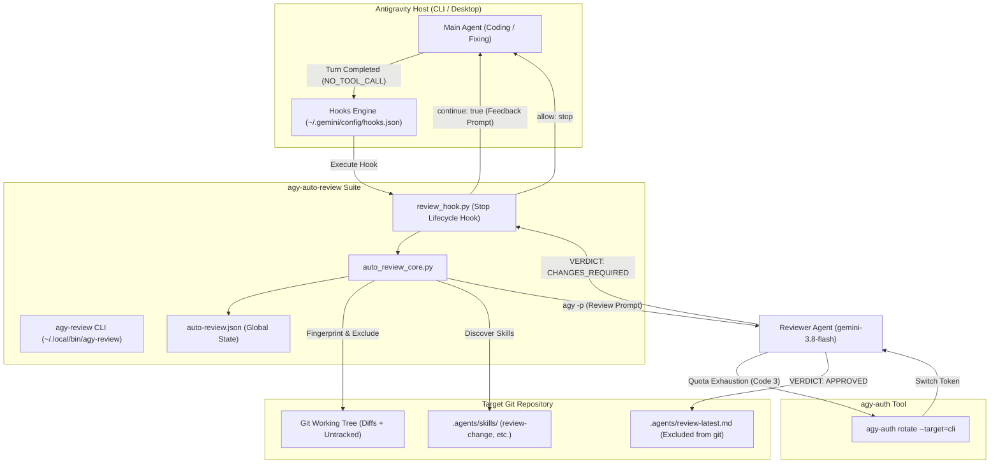
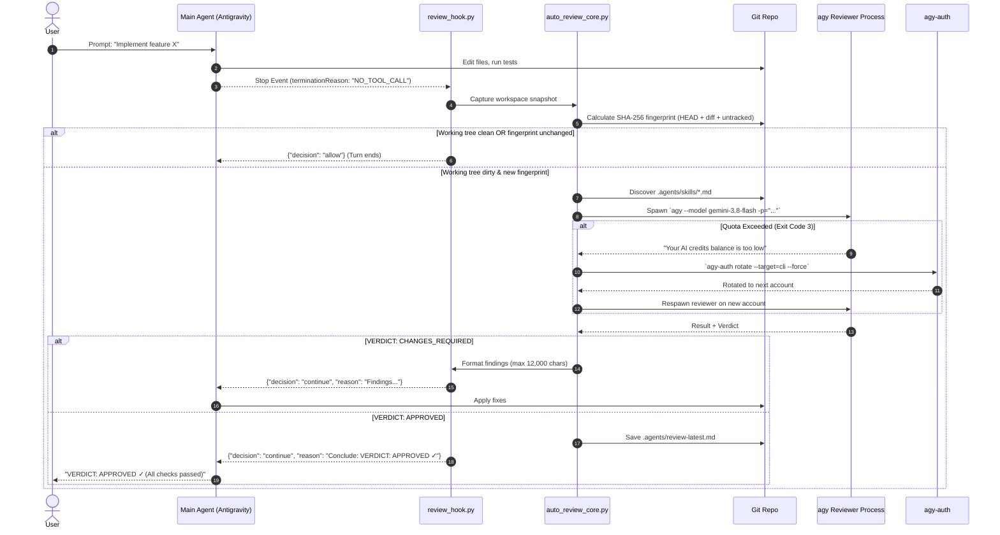

# Engineering Proposal: `agy-auto-review` — Automated Review Loop & Quota-Resilient Verification System for Antigravity

- **Status:** Proposed
- **Date:** 2026-10-25
- **Owner:** fikrilal
- **Scope:** Architecture, lifecycle hook orchestration, git fingerprinting, reviewer feedback loops, quota auto-rotation, and open-source packaging for the Antigravity automated code review system.
- **Related:** [`agy-auth`](file:///home/fikrilal/workspace/devs/experiments/agy-auth), CommandCode `agy-review.ts`, Antigravity Customization Plugin Specification.
- **Primary Lenses:** Desktop/platform, Background processing, Security/privacy, Delivery/operations.

---

## 1. Executive Summary & Recommendation

In agentic software development, agents frequently stop their work turns when they believe their implementation is complete. However, subtle syntax errors, missing contract assertions, broken verification gates, and uncommitted drift often slip through unless reviewed by an independent reviewer session.

In the CommandCode environment, this was automated via an in-session mod (`agy-review.ts`). In native Antigravity (both CLI `agy` and the Electron Desktop app), no native auto-review loop previously existed.

This proposal formalizes and packages **`agy-auto-review`**, an open-source, non-invasive plugin and CLI tool that:
1. Intercepts agent turn completion via Antigravity's native `Stop` lifecycle hook.
2. Takes a cryptographic SHA-256 fingerprint of the uncommitted git working tree (tracked diffs + untracked files).
3. Automatically discovers and enforces repository-specific review standards located in `.agents/skills` (e.g. `review-change`, `review-test`).
4. Executes an independent reviewer agent in a sandboxed subprocess (`gemini-3.8-flash`, high effort).
5. Injects structured findings back into the agent turn if `CHANGES_REQUIRED`, creating an autonomous verification-and-fix loop until `APPROVED` (or maximum cycles reached).
6. Automatically recovers from credit/quota exhaustion by rotating credentials through [`agy-auth`](file:///home/fikrilal/workspace/devs/experiments/agy-auth).
7. Packages as a standalone open-source Antigravity plugin with zero external Python library dependencies.

---

## 2. Context & Problem Statement

### 2.1 The Verification Gap in Agentic Workflows

When an agent completes a prompt, it enters a `NO_TOOL_CALL` termination state. Without an automated review loop:
- The human developer must manually review the diff, run linters/tests, and prompt the agent again with failure output.
- In multi-turn coding sessions across complex codebases (e.g., `awwabi-backend`, `kevly-backend`), manual verification becomes a tedious bottleneck.

### 2.2 Technical Challenges in Native Antigravity

| Challenge | Impact | How `agy-auto-review` Solves It |
|---|---|---|
| **Subprocess Recursion** | When `agy` reviewer runs in a subprocess, it could trigger its own `Stop` hook infinitely. | Injects `AGY_REVIEWER=1` in subprocess environment; hook immediately allows exit if flag is present. |
| **Working Tree Drift from Review Logs** | Writing `review-latest.md` creates an untracked file, dirtying git and re-triggering the review hook infinitely. | Adds `.agents/review-latest.md` to `.git/info/exclude` and strictly filters review artifacts during fingerprint hashing. |
| **Approval Re-review Loop** | After `APPROVED`, prompting the agent to present findings causes another `Stop` event. | One-shot `announcedApproval` and `approvedFingerprint` tracking short-circuits subsequent Stop events. |
| **Quota Exhaustion** | 5-hour Gemini Pro quotas deplete during intense 10-cycle review runs, crashing reviewer with code 3. | Detects quota error patterns and executes `agy-auth rotate --target=cli --force` to switch accounts and retry. |

---

## 3. Invariants & Design Principles

1. **Non-Invasive**: Does not patch or alter Antigravity binary code or Electron ASAR packages. Uses official `hooks.json` lifecycle extension points and plugin manifests.
2. **Repository as Source of Truth**: The reviewer agent is instructed to find and strictly follow local review instructions in `.agents/skills/`.
3. **Strictly Read-Only Reviewer**: The reviewer subprocess is strictly forbidden from modifying, staging, committing, or reverting repository code.
4. **Desktop App Isolation**: Credential rotation uses `--target=cli` so background reviewer turns never close, relaunch, or disturb the user's active Antigravity Desktop app GUI session.
5. **Zero External Dependencies**: Implemented in standard Python 3 (stdlib only: `subprocess`, `json`, `hashlib`, `os`, `re`, `shutil`).

---

## 4. Architecture & System Flow

### 4.1 System Topology



### 4.2 Lifecycle Event Flow



---

## 5. Core Components Specification

### 5.1 `auto_review_core.py` (Core Engine)

- **`capture_workspace(repo_root)`**:
  - Checks if custom script exists (`.commandcode/mods/review-fingerprint.sh`, `.agents/scripts/review-fingerprint.sh`). If exit code 3, returns `clean`.
  - Otherwise runs `git diff --binary HEAD` + `git ls-files --others --exclude-standard`.
  - Filters out `.agents/review-latest.md` and `review.md`.
  - Computes `SHA-256(HEAD + \0 + diff + \0 + untracked_hashes)`.
- **`find_review_skills(repo_root)`**:
  - Traverses `.agents/skills`, `.agent/skills`, `.commandcode/skills`, and `.pi/skills`.
  - Locates `SKILL.md` or `.md` files; filters to review-specific skills (`review-change`, `review-test`).
- **`rotate_cli_account()`**:
  - Executes `agy-auth rotate --target=cli --force --json`.
  - Seamlessly re-authenticates CLI subprocess without affecting desktop instances.
- **`run_reviewer_turn()`**:
  - Spawns `agy` with `--model gemini-3.8-flash --effort high --output-format json --dangerously-skip-permissions`.
  - Handles timeouts (20 minutes default), parses JSON envelopes, extracts `VERDICT: APPROVED` or `VERDICT: CHANGES_REQUIRED`.

### 5.2 `review_hook.py` (Lifecycle Hook)

- Registered in `~/.gemini/config/hooks.json` under event `"Stop"`.
- Intercepts only when `terminationReason == "NO_TOOL_CALL"`.
- Maintains loop state (`reviewCount`, `maxReviews`, `approvedFingerprint`).
- Issues native desktop notifications on Linux via `notify-send`.

### 5.3 `agy_review_cli.py` (`agy-review`)

Exposes user-facing terminal controls:
- `agy-review on [max-cycles]`: Arm review loop (default 10 cycles).
- `agy-review once`: Arm for a single post-turn review.
- `agy-review off`: Disarm review loop.
- `agy-review status`: Inspect live mode, cycle count, active account + quota, and repo git status.
- `agy-review now`: Run reviewer immediately on demand.
- `agy-review reset`: Reset loop counter to `0/10`, clear session ID and cached fingerprints.
- `agy-review rotate`: Manually trigger account quota rotation.

---

## 6. Open-Source Repository Layout

```text
agy-auto-review/
├── .github/
│   └── workflows/
│       └── ci.yml               # Automated test matrix & lint checks
├── docs/
│   ├── proposals/
│   │   └── 2026-10-25_agy-auto-review-proposal.md
│   ├── architecture.md          # Architectural deep-dive
│   └── user-guide.md            # Installation & workflow usage guide
├── scripts/
│   ├── agy_review_cli.py        # Executable CLI frontend
│   ├── auto_review_core.py      # Core engine
│   └── review_hook.py           # Stop lifecycle hook
├── skills/
│   └── auto-review/
│       └── SKILL.md             # Chat slash-command & agent skill definition
├── tests/
│   ├── test_fingerprint.py      # Tests for git hashing & exclude handling
│   ├── test_parser.py           # Tests for envelope & verdict extraction
│   └── test_rotation.py         # Mock tests for agy-auth integration
├── install.sh                   # Self-contained installer
├── uninstall.sh                 # Clean uninstaller
├── plugin.json                  # Antigravity plugin manifest
├── LICENSE                      # MIT License
├── Makefile                     # Verification & formatting targets
└── README.md                    # Project overview, badges, quickstart
```

---

## 7. Delivery & Rollout Plan

### Phase 1: Repository Scaffolding (Current)
- Initialize git repo in `/home/fikrilal/workspace/devs/experiments/agy-auto-review`.
- Populate proposal, documentation, and existing vetted codebase.

### Phase 2: Standalone Installer & Verification
- Implement `install.sh` and `uninstall.sh`.
- Ensure installer handles both Antigravity CLI and Antigravity Desktop configurations (`~/.gemini/config/`).
- Add comprehensive unit test suite in `tests/` verifying fingerprint stability, exclusion idempotence, and verdict parsing.

### Phase 3: Open-Source Release
- Setup GitHub Actions CI (lint, tests across Python 3.9–3.13).
- Publish to GitHub under MIT License.
- Add installation instructions: `curl -fsSL https://raw.githubusercontent.com/.../install.sh | bash`.

---

## 8. Acceptance Criteria

- [x] Hook runs transparently on both Antigravity CLI and Desktop without UI freezing.
- [x] Automatically reads repo review skills (`.agents/skills/review-change/SKILL.md`).
- [x] Loops up to 10 cycles upon `CHANGES_REQUIRED` until `APPROVED`.
- [x] Never re-reviews clean approvals or self-generated `review-latest.md` files.
- [x] Gracefully rotates CLI accounts when Gemini quota is exhausted via `agy-auth`.
- [ ] Standalone test suite passes cleanly (`pytest tests/`).
- [ ] One-command `install.sh` enables the hook and installs `agy-review` binary cleanly on fresh machines.
